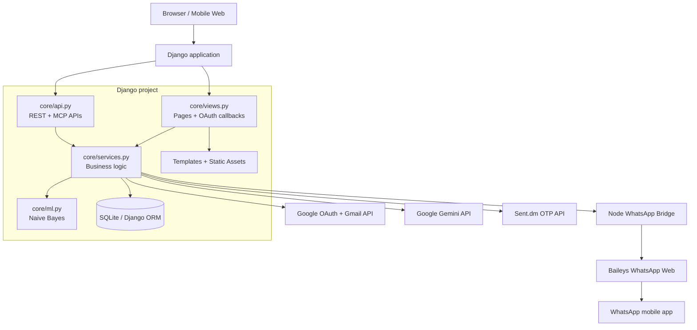
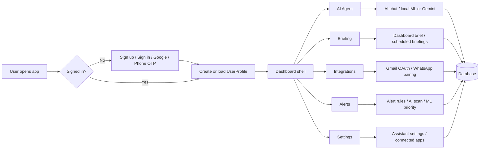
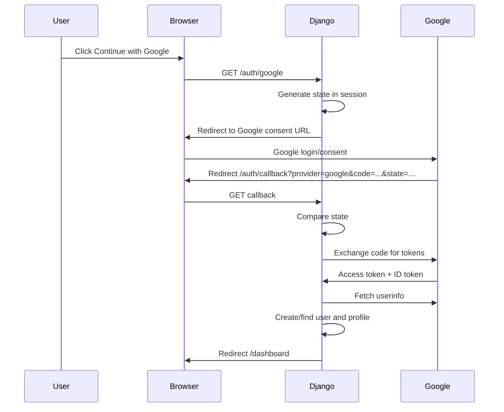
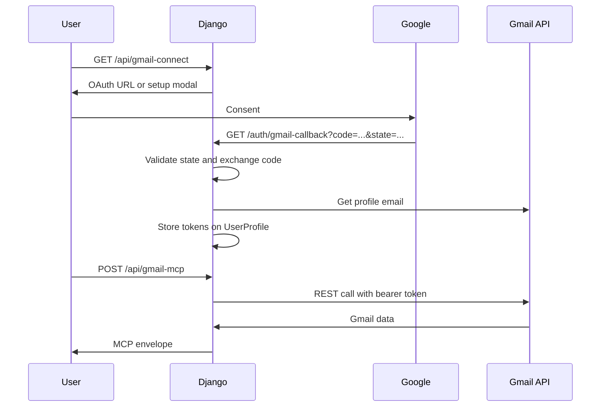
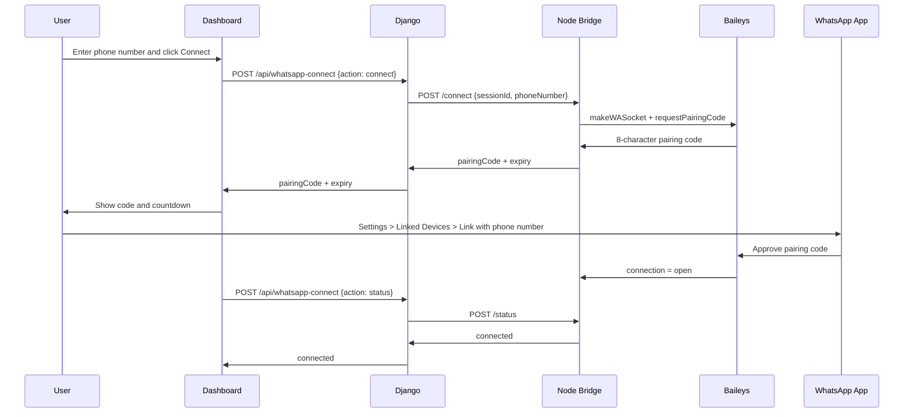
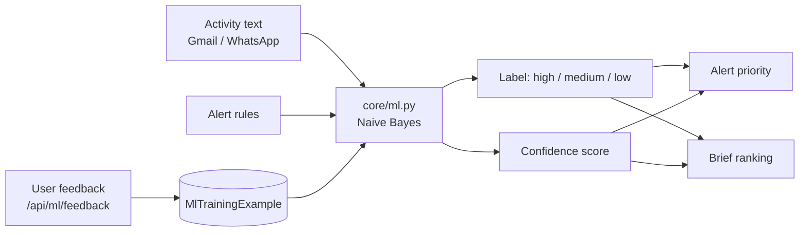

# OmniSync.ai — Full Django + Node Implementation

**Project date: 21/11/2026**

OmniSync.ai is a personal productivity agent that unifies Gmail, WhatsApp, AI chat, alerts, briefings, follow-ups, settings, and mobile pairing in one dashboard. This repository is a full Django port of the original Next.js application, with the original routes, API contracts, MCP-style envelopes, screens, and product behavior preserved.

The Python application is credential-free by default for demo usage, but real integrations are supported:

- Real Google sign-in with OAuth `state`, code exchange, email verification, and Django login.
- Real Gmail MCP over the Gmail REST API, with explicit simulated mode as opt-in only.
- Real WhatsApp Web linking through a local Node/Baileys bridge and WhatsApp's **Link with phone number** pairing code.
- Real OTP delivery through Sent.dm when credentials are configured.
- Real Gemini responses when `GEMINI_API_KEY` is configured; otherwise a local Naive Bayes ML classifier provides deterministic intelligence.

---

## 1. Technology stack

| Layer | Technology | Purpose |
|---|---|---|
| Web framework | Django 5.x/6.x | Pages, auth, REST APIs, ORM, session handling |
| Templates | Django templates | Server-rendered landing, auth, dashboard, briefing pages |
| Frontend | Vanilla CSS + `static/app.js` | Dashboard tabs, API calls, modals, toasts, polling |
| Database | SQLite by default | Local persistent storage for all app data |
| AI fallback | Custom Multinomial Naive Bayes | Priority prediction, ranking, local chat responses |
| External AI | Google Gemini | Optional live AI chat, briefings, alert analysis |
| Email integration | Gmail REST API | Real Gmail MCP operations |
| WhatsApp integration | Node.js + `@whiskeysockets/baileys` | Real WhatsApp Web pairing and messaging |
| Authentication | Django auth + Google OAuth + phone OTP | Email/password, Google, and OTP login |
| Jobs | Django management command | Due briefing and alert generation |

---

## 2. Full project structure

```text
AI-PERSONAL-OMINISYNC/
└── ominisync/
    ├── manage.py
    ├── requirements.txt
    ├── README.md
    ├── .env.example
    ├── .gitignore
    │
    ├── config/
    │   ├── __init__.py
    │   ├── settings.py
    │   ├── urls.py
    │   ├── wsgi.py
    │   └── asgi.py
    │
    ├── core/
    │   ├── __init__.py
    │   ├── api.py
    │   ├── apps.py
    │   ├── context_processors.py
    │   ├── ml.py
    │   ├── models.py
    │   ├── services.py
    │   ├── urls.py
    │   ├── views.py
    │   ├── tests.py
    │   │
    │   ├── migrations/
    │   │   ├── 0001_initial.py
    │   │   ├── 0002_alter_whatsappmessage_message_id_and_more.py
    │   │   ├── 0003_alter_generatedbriefing_id.py
    │   │   └── 0004_mltrainingexample.py
    │   │
    │   └── management/
    │       ├── __init__.py
    │       └── commands/
    │           ├── __init__.py
    │           └── run_due_jobs.py
    │
    ├── whatsapp_bridge/
    │   ├── package.json
    │   ├── package-lock.json
    │   ├── index.js
    │   └── sessions/                 # ignored; runtime Baileys credentials
    │
    ├── templates/
    │   ├── base.html
    │   ├── landing.html
    │   ├── sign_in.html
    │   ├── sign_up.html
    │   ├── auth_callback.html
    │   ├── gmail_callback.html
    │   ├── pair.html
    │   ├── offline.html
    │   ├── dashboard.html
    │   └── briefing_detail.html
    │
    ├── static/
    │   ├── app.js
    │   ├── style.css
    │   ├── manifest.webmanifest
    │   ├── sw.js
    │   ├── icons/
    │   ├── 001-gmail.png
    │   ├── 002-whatsapp.png
    │   └── ... other copied public assets
    │
    └── db.sqlite3                    # ignored; created by migrate
```

---

## 3. Directory responsibility table

| Path | Responsibility |
|---|---|
| `config/settings.py` | Django configuration, `.env` loading, OAuth variables, allowed hosts, apps, middleware |
| `config/urls.py` | Root URLConf; includes `core.urls` |
| `core/models.py` | All persistent tables: users, profiles, OTPs, Gmail, WhatsApp, alerts, briefings, ML examples |
| `core/views.py` | Landing/auth/dashboard pages, Google OAuth callbacks, Gmail callback, root static files |
| `core/api.py` | JSON APIs and MCP envelopes |
| `core/services.py` | Business logic, Gmail MCP, WhatsApp MCP, alert/briefing generation, OTP, settings, bridge client |
| `core/ml.py` | Local Naive Bayes classifier and feedback training |
| `core/tests.py` | Full regression suite covering pages, auth, APIs, OAuth, ML, and integrations |
| `core/management/commands/run_due_jobs.py` | Scheduled alert and briefing generation |
| `templates/` | Django templates for every product page |
| `static/app.js` | Frontend behavior, dashboard interactions, modals, API polling |
| `whatsapp_bridge/index.js` | Local Baileys HTTP bridge for real WhatsApp pairing and messaging |

---

## 4. Architecture diagram



---

## 5. Main workflow



---

## 6. Quick start

### Python application

Requirements: Python 3.12+, Django from `requirements.txt`.

```bat
cd C:\Users\bmani\OneDrive\Desktop\github\ominisync
python -m pip install -r requirements.txt
python manage.py migrate
python manage.py runserver 127.0.0.1:8000
```

Open:

```text
http://127.0.0.1:8000/
```

### WhatsApp bridge

Requirements: Node.js 20+.

```bat
cd whatsapp_bridge
npm install
node index.js
```

The Django service auto-starts the bridge on first WhatsApp connect/status request, but manual start is useful for debugging. The bridge listens on:

```text
http://127.0.0.1:3001
```

If PowerShell blocks `npm.ps1`, use:

```bat
npm.cmd install
```

---

## 7. Environment variable table

Copy `.env.example` to `.env`. Never commit `.env`.

| Variable | Purpose | Default |
|---|---|---|
| `DJANGO_SECRET_KEY` | Django signing key | Local insecure key |
| `DJANGO_DEBUG` | Debug mode | `1` |
| `DJANGO_ALLOWED_HOSTS` | Comma-separated allowed hosts | `127.0.0.1,localhost,testserver` |
| `GEMINI_API_KEY` | Enables live Gemini calls | Empty; local ML fallback |
| `GEMINI_CHAT_MODEL` | Chat model | `gemini-3.1-flash-lite` |
| `GEMINI_MODEL` | Briefing/alert model | `gemini-2.5-flash` |
| `GOOGLE_CLIENT_ID` | Google sign-in and Gmail OAuth | Empty |
| `GOOGLE_CLIENT_SECRET` | Google sign-in and Gmail OAuth | Empty |
| `GOOGLE_REDIRECT_URI` | Gmail OAuth redirect | `http://127.0.0.1:8000/auth/gmail-callback` |
| `GOOGLE_SIGNIN_REDIRECT_URI` | Google sign-in redirect | `http://127.0.0.1:8000/auth/callback?provider=google` |
| `SENT_DM_API_KEY` | Real OTP delivery | Empty |
| `SENT_DM_TEMPLATE_ID` | Sent.dm template | Original demo template ID |
| `PHONE_AUTH_RETURN_OTP` | Return OTP in local responses | `1` |
| `MOBILE_API_KEY` | Mobile pairing key | Demo key |
| `APP_URL` | Public app URL | `http://127.0.0.1:8000` |

---

## 8. Authentication workflow



Supported login methods:

| Method | Route | Credentials required |
|---|---|---|
| Email/password | `/sign-in`, `/sign-up` | None |
| Google OAuth | `/auth/google` | `GOOGLE_CLIENT_ID`, `GOOGLE_CLIENT_SECRET` |
| Phone OTP | `/api/phone-auth/send-otp`, `/api/phone-auth/verify-otp` | Optional `SENT_DM_API_KEY` |

---

## 9. Gmail integration workflow



Rules:

- New profiles start with Gmail disconnected.
- Real Gmail OAuth never silently falls back to simulation.
- Simulated Gmail is enabled only by clicking **Use Simulated Mode**.
- Disconnect revokes the Google token when available.

---

## 10. WhatsApp integration workflow



WhatsApp bridge endpoints:

| Endpoint | Purpose |
|---|---|
| `GET /health` | Bridge health check |
| `POST /connect` | Start Baileys socket and request pairing code |
| `POST /status` | Return connection status and active pairing code |
| `POST /disconnect` | Logout and delete local session files |
| `POST /mcp` | Execute real WhatsApp MCP methods |

Runtime session files are written to `whatsapp_bridge/sessions/` and are git-ignored because they contain private WhatsApp credentials.

---

## 11. Routes table

### Pages

| Route | Purpose |
|---|---|
| `/` | Landing page |
| `/sign-in` | Email/password and Google sign-in |
| `/sign-up` | Create account |
| `/sign-out` | Logout |
| `/auth/google` | Start Google sign-in |
| `/auth/callback?provider=google` | Google sign-in callback |
| `/auth/gmail-callback` | Gmail OAuth callback |
| `/pair` | Mobile API key pairing page |
| `/offline` | Offline fallback |
| `/dashboard` | Main dashboard |
| `/dashboard?tab=<tab>` | Dashboard tabs: `ai-agent`, `briefing`, `integrations`, `alerts`, `inbox`, `follow-ups`, `settings`, `pricing` |
| `/dashboard/briefing/<uuid>?category=<category>` | Briefing detail |

### APIs

| Endpoint | Purpose |
|---|---|
| `/api/dashboard-brief` | Unified brief from Gmail, WhatsApp, alerts, and ML |
| `/api/ai-chat` | Gemini or local ML chat |
| `/api/chat/history`, `/api/chat/clear` | Chat persistence |
| `/api/briefings`, `/api/briefings/schedules`, `/api/briefings/ai-draft` | Briefing CRUD and generation |
| `/api/gmail-connect`, `/api/gmail-mcp` | Gmail OAuth and MCP |
| `/api/whatsapp-connect`, `/api/whatsapp-mcp` | WhatsApp pairing and MCP |
| `/api/alerts`, `/api/alerts/rules`, `/api/alerts/generate`, `/api/alerts/suggestions`, `/api/alerts/actions`, `/api/alerts/ai` | Alert system |
| `/api/phone-auth/send-otp`, `/api/phone-auth/verify-otp` | Phone login |
| `/api/mobile/connect` | Mobile pairing |
| `/api/integrations/disconnect` | Disconnect integrations |
| `/api/waitlist` | Waitlist signup |
| `/api/assistant-settings` | Assistant preferences |
| `/api/realtime-events` | Realtime event feed |
| `/api/ml/predict`, `/api/ml/feedback` | ML prediction and training feedback |

---

## 12. Database model table

| Model | Purpose |
|---|---|
| `User`, `UserProfile` | Authentication and OmniSync profile state |
| `OtpCode` | Phone OTP codes and expiry |
| `WaitlistEntry` | Landing page waitlist |
| `ChatMessage` | AI chat history |
| `GmailMessage` | Simulated/local Gmail message cache |
| `WhatsAppContact` | WhatsApp contacts and groups |
| `WhatsAppMessage` | WhatsApp local message cache |
| `WhatsAppSession` | Pairing state and integration status |
| `AlertRule` | User alert rules |
| `Alert` | Generated alerts |
| `BriefingSchedule` | Scheduled briefings |
| `GeneratedBriefing` | Generated briefing records with UUID primary keys |
| `MlTrainingExample` | Feedback examples used to retrain local classifier |
| `RealtimeEvent` | Dashboard realtime event feed |

---

## 13. ML workflow



The classifier is dependency-free and starts with a labeled seed corpus. Explicit feedback inserts examples into `MlTrainingExample`, which are included in later predictions.

---

## 14. Jobs

```bat
python manage.py run_due_jobs
python manage.py run_due_jobs --profile-id <uuid>
```

This command generates due briefings and alerts for all profiles or one selected profile.

---

## 15. Verification

```bat
python manage.py check
python manage.py makemigrations --check --dry-run
python manage.py test
node --check whatsapp_bridge/index.js
```

The test suite covers:

- pages and static assets
- email/password auth
- Google OAuth sign-in flow
- phone OTP
- Gmail real OAuth and simulated opt-in
- Gmail MCP
- WhatsApp connect and MCP
- ML prediction and feedback
- briefings and schedules
- alerts
- settings, events, waitlist, and legacy `userId` compatibility

---

## 16. Security notes

- `.env` is git-ignored.
- `db.sqlite3` is git-ignored.
- WhatsApp Baileys session credentials under `whatsapp_bridge/sessions/` are git-ignored.
- Google OAuth `state` is generated server-side and validated before code exchange.
- Gmail and Google sign-in redirects must be registered exactly in Google Cloud Console.
- For production, set `DJANGO_DEBUG=0`, a strong `DJANGO_SECRET_KEY`, proper `DJANGO_ALLOWED_HOSTS`, HTTPS, and a real database.
- Do not commit OAuth client secrets, access tokens, refresh tokens, Baileys keys, or production databases.

---

## 17. Original behavior preserved

- Original route names and dashboard tabs.
- Original MCP response envelopes.
- Original Gmail, WhatsApp, AI agent, briefing, alert, settings, follow-up, and mobile pairing screens.
- Original trusted `userId` compatibility for APIs.
- Original product flow while replacing the unavailable backend with Django + local services.
